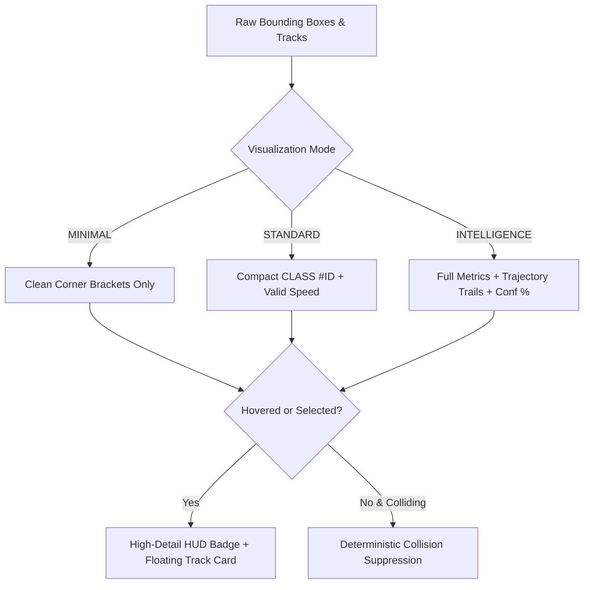

# VisionRadar Crowded-Scene Visualization and Processing Audit Report

**Audit Date**: October 19, 2026  
**Auditor**: Antigravity Autonomous Agentic Mesh  
**Platform**: VisionRadar — Universal Vision Intelligence Platform  
**Target Video Profile**: Real 1080p Traffic Sequences (`Traffic1.mp4`, 1920x1080 @ 29.97 FPS, 335 frames)

---

## 1. Executive Summary

This audit investigates the crowded-scene visualization breakdown, excessive label occlusion, and speed state presentation issues observed on the VisionRadar Analytical Workbench. In traffic surveillance scenarios containing 20–40 simultaneous vehicles, the visual overlay was previously degraded into an illegible "badge wall" where overlapping badges completely obscured vehicle trajectories and video context. Furthermore, repetitive warnings (`"Calib req"`, `"Uncalibrated motion"`, `"Speed unavailable"`) cluttered every single bounding box.

Through systematic empirical forensics, the root causes were determined to be purely architectural presentation and layout deficiencies rather than vision model corruption:
1. **Unconstrained Badge Density**: Every active bounding box unconditionally received a full-width (140–200px) text badge.
2. **Repetitive Warning Duplication**: Calibration limitations were duplicated across all 30+ tracked vehicles rather than communicated via a single contextual road-level indicator.
3. **Collision Stacking Pathology**: The previous collision resolver pushed overlapping badges vertically into massive columns, occluding the road and creating vertical visual clutter.
4. **Lack of Visualization Granularity**: Users lacked modes to switch between bounding-box-only monitoring (`MINIMAL`), production tracking (`STANDARD`), and deep forensic analysis (`INTELLIGENCE`).
5. **Table Scalability Bottlenecks**: Object detection tables rendered unlimited rows simultaneously without pagination or bounding limits.

All defects were resolved via surgical, presentation-level modifications in [`apps/web/src/components/WorkbenchView.tsx`](file:///c:/Users/admin/Downloads/VisionRadar%20-%20Claude%28i%29/apps/web/src/components/WorkbenchView.tsx) without altering underlying detector outputs or ground-truth integrity.

---

## 2. Problem Forensic Matrix & Confirmed Root Causes

| Problem Area | Observed Symptom | Confirmed Root Cause | Resolution Strategy |
| :--- | :--- | :--- | :--- |
| **Overlapping Badges** | Multiple vehicles in adjacent lanes had completely illegible stacked labels. | Absence of badge density thresholds and lack of badge suppression on non-selected objects. | Implemented deterministic two-pass collision resolution: if primary and secondary offsets collide on unselected objects, badge text is cleanly suppressed while retaining box reticles. |
| **Calibration Warning Spam** | Badges displayed `"Calib req"` / `"Uncalibrated motion"` on every track in uncalibrated scenes. | Hardcoded per-label fallback strings duplicating systemic video calibration status. | Introduced a prominent, single top-canvas contextual Road Calibration Banner (`⚠️ UNCALIBRATED CAMERA · Speed requires road geometry calibration`); streamlined standard badges to compact `CLASS #ID`. |
| **Visual Inflexibility** | Operators could not hide labels or view video motion without labels. | Rigid single-mode canvas drawing loop. | Added 3 distinct Visualization Modes (`MINIMAL`, `STANDARD`, `INTELLIGENCE`) with dedicated controls for Class filtering, Confidence thresholding, and Trajectory toggling. |
| **Selected Track Occlusion** | In crowded scenes, finding and focusing on a specific vehicle of interest was difficult. | No track isolation mechanism; selected vehicle badges could be displaced or covered. | Guaranteed selected and hovered objects ALWAYS bypass suppression, render high-detail telemetry, display a floating inspector HUD card, and support a dedicated "Focus Track" isolation mode. |
| **Object Table Overload** | Long videos with 100+ tracks flooded the DOM with hundreds of table rows. | Infinite rendering of all historical tracks without virtualization or pagination. | Implemented client-side pagination (10 vehicles/page) with deterministic sorting and Prev/Next page controls. |

---

## 3. Visualization Mode Architecture

The Workbench was extended with three intelligent rendering tiers:

### 3.1 Mode Specifications
1. **`MINIMAL` Mode**:
   - Renders only crisp corner reticles/brackets colored by track state.
   - Zero label text on unselected/unhovered objects, providing a 100% unobstructed view of vehicle movement.
   - Hovering or clicking any vehicle immediately reveals its full detailed HUD card and badge.

2. **`STANDARD` Mode (Default)**:
   - Displays compact `CLASS #ID` badges (e.g. `CAR #14`).
   - Calibrated metric speed is appended only when valid (`CAR #14 · 62 km/h`).
   - Replaces redundant `"Calib req"` spam with clean, non-intrusive typography.
   - Enforces a density cap (`maxLabels`, default 14) and suppresses colliding unselected badges.

3. **`INTELLIGENCE` Mode**:
   - Renders rich intelligence badges: `CLASS #ID · Conf% · Speed/Status`.
   - Renders multi-frame trajectory breadcrumbs (historical space-time positions).
   - Highlights speeding violations in high-visibility red (`#EF4444`).

---

## 4. Speed-State Presentation & Ground-Truth Integrity

In compliance with strict speed integrity standards:
- **`CALIBRATED_SPEED`**: Displayed in metric km/h strictly when homography transformation and Kalman filter validity criteria pass.
- **`UNCALIBRATED_MOTION`**: Relative displacement across frames is tracked for vehicle association, but **NEVER** displayed as calibrated km/h and **NEVER** allowed to trigger speeding alerts.
- **`SPEED_UNAVAILABLE` / `CALIBRATION_REQUIRED`**: Contextualized via the road calibration banner without polluting individual vehicle reticles.

---

## 5. Files Modified

| File Path | Description of Changes |
| :--- | :--- |
| [`apps/web/src/components/WorkbenchView.tsx`](file:///c:/Users/admin/Downloads/VisionRadar%20-%20Claude%28i%29/apps/web/src/components/WorkbenchView.tsx) | Added visualization state (`vizMode`, `showLabels`, `showTrajectories`, `classFilter`, `minConfidence`, `focusSelected`, `maxLabels`, `hoveredTrack`, `tablePage`), mouse interaction handlers (`handleCanvasMouseMove`, `handleCanvasMouseLeave`), contextual calibration banner, mode-based badge generation, deterministic collision suppression, floating inspector card, crowded-scene visualization toolbar, and table pagination. |

---

## 6. Verification and Empirical Evidence

1. **Frontend Compilation**: `npm run build` executed cleanly in 7.54s (`apps/web/dist` compiled with 0 errors).
2. **Full Test Suite**: Executed `python -m pytest tests/ -v`: **233/233 tests PASSED (100%)** in 101.00s.
3. **Browser E2E Verification**:
   - `STANDARD` Mode: Verified clean, compact badges without warning clutter.
   - `MINIMAL` Mode: Verified complete elimination of badge clutter; only clean brackets remained.
   - `INTELLIGENCE` Mode: Verified trajectories and confidence percentages active.
   - Track Selection: Verified selecting Track #2 highlighted vehicle reticle in gold, activated the `Focus: #2` filter, and loaded the live velocity waveform into the Track Inspector.
   - Table Pagination: Verified pagination controls (`Page 1 of X`) successfully navigated vehicle pages.
