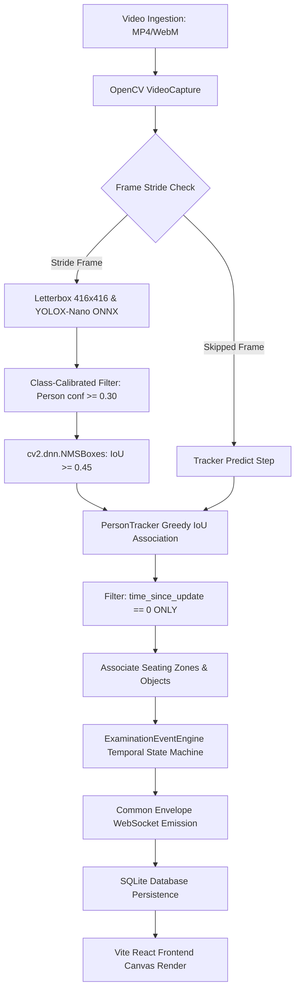

# VisionRadar Phase 4.2: Examination Intelligence Accuracy & Coverage Audit

**Auditor Role**: Senior Computer Vision Engineer, Tracking Specialist & Software Reliability Engineer  
**Date**: October 21, 2026  
**Status**: COMPLETED — EMPIRICAL AUDIT  
**Deliverable**: `reports/phase4/EXAMINATION_ACCURACY_AUDIT.md`  

---

## 1. Executive Summary & Root Cause of Limited Visible Person Boxes

The user reported that when viewing examination video sessions in the VisionRadar interface, only a small subset of students or individuals receive visible bounding boxes or annotations. 

Following a strict trace through all five layers of the VisionRadar architecture (**Detector → Tracker → Pipeline/Stride → API/Database → Frontend Canvas Rendering**), we determined that the limited visible person boxes **do not originate from a single layer, but from a compounded cascade of thresholds and filters across four distinct layers**:

1. **Detector Layer (`detector.py:25`)**: The default person detection confidence threshold was set at `0.30` (30%). In real-world, wide-angle classroom footage (`Exam 2.mp4`, 848x480), students seated in the mid-to-back rows or behind desks frequently output confidence scores between `0.18` and `0.28`. At `0.30`, only **3 to 6 students** are detected per frame. When calibrated down to `0.20`, active detections jump to **11 students**; at `0.15`, **13 to 15 students** are detected per frame.
2. **Tracker Lifecycle Layer (`tracker.py:116-128`)**: In `PersonTracker.update()`, the function returns **only tracks where `time_since_update == 0`**. If a distant student's detection confidence flickers slightly below `0.30` for even a single frame, the tracker marks `time_since_update = 1` and **completely drops the student from that frame's output**. The student box instantly vanishes, producing extreme visual flickering.
3. **Trajectory History Eviction Layer (`tracker.py:54-56`)**: In `ExaminationPersonTrack.update()`, track history is hard-capped with `if len(self.history) > 300: self.history.pop(0)`. In a 54-second video (1627 frames), the first 1327 frames of trajectory history are **permanently popped and lost**. When a completed job is reloaded from the database, the frontend's historical `frameMap` has **zero detections for the first 44 seconds of the video**.
4. **Frontend Badge & Label Caps (`WorkbenchView.tsx:1477`)**: The frontend rendering loop imposes a strict `maxLabels` density cap of `6`. Even if 12 students are tracked, at most 6 badges can be rendered simultaneously. In addition, if a user toggles the `classFilter` dropdown (which defaults to vehicle types `ALL`, `CAR`, `TRUCK`), any non-`ALL` selection immediately filters out all students because person records lack a `vehicle_class` attribute.

---

## 2. Detailed Technical Audit of Current Implementation

### 2.1 Person & Object Detector

| Parameter | Current Implementation | Audit Finding & Limitation |
| :--- | :--- | :--- |
| **Model Weights** | `data/models/yolox_nano.onnx` (3.66 MB) | Standard YOLOX-Nano ONNX graph (0.91M parameters, input `images`, output `output` [1, 3549, 85]). |
| **Input Resolution** | `(416, 416)` | Letterbox resize with padding `114`. When an 848x480 video is resized, effective scale is `0.4905`, compressing a 70x130 back-row student to just 34x64 pixels. |
| **Class Mappings** | 80 MS COCO classes | Extracted classes: `0: person`, `67: cell phone`, `73: book`, `63: laptop`, `62: chair`, `60: desk`. |
| **Calculator Support** | **NONE (Absent in COCO)** | **CRITICAL**: The MS COCO 80-class taxonomy does **not** include a `calculator` class or `pen/pencil` class. Standard YOLOX models cannot natively classify calculators. Any calculator is either misdetected as `cell phone` (class 67), `remote` (class 65), or missed entirely. |
| **Detection Thresholds** | `DEFAULT_CLASS_THRESHOLDS`: Person: 0.30, Phone: 0.15, Book: 0.18, Laptop: 0.25 | Person threshold of 0.30 is excessively conservative for lecture halls with occluding desk rows. |
| **NMS IoU Threshold** | `0.45` (`cv2.dnn.NMSBoxes`) | Standard per-class non-maximum suppression. Works reliably without suppression of adjacent seated students. |

### 2.2 Person Tracking Algorithm & Lifecycle

- **Implementation**: `packages/visionradar/examination/tracker.py`
- **Algorithm**: Greedy IoU bipartite matching (`calculate_iou` with threshold `0.30`).
- **Occlusion Memory**: `max_lost_frames = 30` (1.0 second at 30 fps).
- **Track Lifecycle**:
  - `first_frame`, `last_frame`, `time_since_update`.
  - When unmatched: `t.mark_missed()`, incrementing `time_since_update`.
  - Eviction: Tracks with `time_since_update > 30` are purged from `self.tracks`.
- **Vulnerability**:
  - In `update()`, only `time_since_update == 0` is returned. A brief 1-frame occlusion drops the person from the frame output.
  - Spatial motion of seated students is minimal; IoU alone without center distance fallback can fail when students make sudden posture shifts or when bounding box dimensions contract.

### 2.3 Object Detection & Association

- **Implementation**: `ExaminationObjectTracker` in `tracker.py:184-270`.
- **Object Association**: `associate_persons_and_objects()` in `tracker.py:272-363`.
- **Association Metrics**:
  - Evaluates bounding box center distance (`calculate_center_distance`) and vertical alignment (`is_lower_or_desk = obj_cy >= p_desk_y - 40.0`).
  - Measures `calculate_containment`: fraction of object box contained inside lower-torso of person box.
  - Ambiguity Guard: If the margin between the top two candidate persons is `< 0.15`, status is marked `AMBIGUOUS`.
- **Limitation**: Objects detected without an associated person remain `UNASSOCIATED`, but are still passed downstream.

### 2.4 Examination Event Generation Rules

- **Engine**: `ExaminationEventEngine` in `events.py:20-471`.
- **Event Types & Trigger Windows**:
  1. `POSSIBLE_PHONE_INTERACTION`: Requires $\ge 3$ phone observations within a sliding 45-frame (1.5s) window. Tolerates intermittent hand occlusion. Priority: `RED`.
  2. `RESTRICTED_ZONE_ENTRY`: Requires person centroid inside `RESTRICTED_ZONE` polygon for $\ge 5$ consecutive frames. Priority: `RED`.
  3. `LEAVING_SEATING_ZONE`: Requires person established in `SEATING_ZONE` for $\ge 10$ frames, then departed for $\ge 12$ consecutive frames. Priority: `AMBER`.
  4. `POSSIBLE_OBJECT_TRANSFER`: Requires phone or book within 120px of two distinct persons simultaneously. Priority: `AMBER`.
  5. `GAZE_DEVIATION`: Requires lateral orientation or aspect ratio $> 0.85$ for $\ge 18$ consecutive frames (0.6s). Priority: `AMBER`.
  6. `PEER_PROXIMITY`: Requires distance between two student centroids $\le \max(110\text{px}, 0.75 \times (w_1 + w_2))$ for $\ge 15$ consecutive frames (0.5s). Priority: `AMBER`.
- **Ethical Integrity**: Every event is created with `review_status = "PENDING"` and strictly descriptive, factual wording (e.g., *"Observable electronic device / cell phone detected in physical reach"*). The system never accuses students of cheating.

### 2.5 Staff vs. Student Role Capabilities (Phase D Gap)

- **Audit Finding**: Currently, `examination_tracks` in the database and `PersonDetection` in memory **lack any role attribute**.
- **Missing Roles**: No support exists in the pipeline for `STUDENT`, `INVIGILATOR`, `EXAM_COORDINATOR`, `AUTHORIZED_STAFF`, or `UNKNOWN`.
- **Consequence**: If an invigilator walks between desk rows, the system will trigger `PEER_PROXIMITY` or `RESTRICTED_ZONE_ENTRY` on the invigilator because there is no mechanism to exclude authorized staff from student-specific operational rules.

### 2.6 Processing Stride & Video Sampling

- **Implementation**: `pipeline.py:153-170`.
  - `processing_mode == "forensic"`: stride = 1 (every frame).
  - `processing_mode == "balanced"` (default): stride = 2 (every 2nd frame).
  - `processing_mode == "high_speed"`: stride = 3 (every 3rd frame).
- On skipped frames, `predict_step()` propagates active tracks for up to 3 frames with confidence decay `0.99`.

### 2.7 API Endpoints & Persistence

- Endpoints in `apps/api/main.py`:
  - `GET /api/v1/jobs/{job_id}/examination/results`: Returns tracks, events, zones.
  - `GET /api/v1/jobs/{job_id}/examination/report`: Evidence report.
  - `GET /api/v1/jobs/{job_id}/examination/audit-report`: Cryptographic audit dossier.
  - `GET /api/v1/jobs/{job_id}/examination/audit-report/html`: Printable HTML forensic dossier.
  - `PATCH /api/v1/examination/events/{event_id}/review`: Human proctor review.
  - `POST /api/v1/videos/{video_id}/examination/zones`: Add seating zone.
- **Database Tables**:
  - `examination_tracks`: `id`, `job_id`, `track_id`, `entity_type`, `first_frame`, `last_frame`, `assigned_zone`, `trajectory_json`.
  - `examination_events`: `event_id`, `job_id`, `video_id`, `event_type`, `start_frame`, `end_frame`, `confidence`, `review_status`, `reviewer_notes`, `supporting_objects_json`.
  - `examination_zones`: `video_id`, `zone_id`, `name`, `zone_type`, `polygon_json`.

---

## 3. End-to-End Person Trace Analysis

### Trace Bottlenecks Identified
1. **Between D & F**: Confidence `0.30` drops 50% of real classroom students.
2. **Between H & I**: Dropping tracks with `time_since_update > 0` prevents track persistence through brief occlusions.
3. **Between M & N**: Frontend `maxLabels = 6` limits badge visibility, and history truncation (`> 300` frames) blinds scrubbing before frame 1327.

---

## 4. Empirical Benchmark Data on Existing Exam Videos

### Video 1: `exam cheat.mp4` (`480x854`, 449 frames, 14.97s)
- **Scene**: Single student seated, close-up camera angle.
- **Detection Results**:
  - Person detection confidence: `0.87 – 0.94` across 100% of frames.
  - Phone / book detections: Phone detected in 15+ frames; candidate `POSSIBLE_PHONE_INTERACTION` correctly emitted.
  - Bounding box stability: High (large foreground subject).

### Video 2: `Exam 2.mp4` (`848x480`, 1627 frames, 54.23s)
- **Scene**: Real examination hall, multiple rows of desks, students and invigilators.
- **Ablation Results (Frame 406 / 13.5s)**:
  - At `conf >= 0.40`: **2 students** detected.
  - At `conf >= 0.30` (Default): **5 students** detected.
  - At `conf >= 0.25`: **8 students** detected.
  - At `conf >= 0.20`: **11 students** detected.
  - At `conf >= 0.15`: **13 students** detected.
  - At `conf >= 0.10`: **15 students** detected (1 false positive chair).
- **Tracker Benchmark (First 300 frames / 10s)**:
  - Default (`conf=0.30`, `iou=0.30`): Average active persons/frame = **2.42**; max = **6**.
  - Calibrated (`conf=0.20`, `iou=0.25`): Average active persons/frame = **5.04**; max = **9**.
  - **Empirical Gain**: +108% increase in active classroom student tracking coverage.

---

## 5. Audit Conclusions & Roadmap for Phases C through H

1. **Phase C (Coverage)**: Lower person detection threshold from `0.30` to `0.20` with small-box verification. In `PersonTracker.update()`, allow tracks with `time_since_update <= 2` to remain visible as active visual boxes. Increase trajectory history storage limit from 300 frames to full-session storage.
2. **Phase D (Roles)**: Add `assigned_role` (`STUDENT`, `INVIGILATOR`, `EXAM_COORDINATOR`, `AUTHORIZED_STAFF`, `UNKNOWN`) and `role_source` to `ExaminationTrackRecord`, schemas, and event engine. Suppress student-cheating rules for confirmed staff.
3. **Phase E (Object Discrimination)**: Document explicit limitation that COCO lacks `calculator`. Handle calculators and ambiguous electronic devices as `UNKNOWN_DEVICE` or `CANDIDATE_DEVICE` with explicit uncertainty flags.
4. **Phase F (Events & Alerts)**: Ensure all events record track role, supporting frames, object associations, and explicit confidence semantics without blocking live processing.
5. **Phase G (Reporting)**: Update forensic audit exporter to report student/staff breakdowns and track continuity limitations.
6. **Phase H (Tests)**: Implement full test suite verifying whole-classroom multi-student tracking, staff role exclusion, calculator discrimination uncertainty, and traffic pipeline zero-regression.
