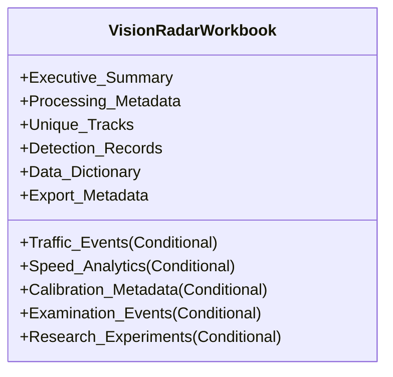
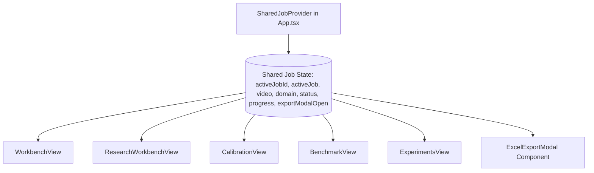

# VisionRadar Phase 5: Excel Export & Shared Job Context Design

**Author**: Principal Software Architect, Senior Full-Stack Engineer & Excel Reporting Specialist  
**Date**: October 21, 2026  
**Status**: APPROVED DESIGN SPECIFICATION  
**Deliverable**: `reports/phase5/EXCEL_EXPORT_DESIGN.md`  

---

## 1. Objectives & Principles

The Excel Export Engine serves as the enterprise analytical reporting gateway for VisionRadar. The workbook must:
1. **Support Both Domains**: Provide dedicated sheets for **Traffic Intelligence** (speeds, violations, calibration, vehicle classifications) and **Examination Intelligence** (monitored students, staff roles, candidate anomalies, seating zones).
2. **Support Two Modes**:
   - `final`: Exports all finalized database records for a completed job.
   - `snapshot`: Exports available records at the current point in time without interrupting live video inference.
3. **Prevent Metric Fabrication**: If a metric is not available (e.g. speed on an uncalibrated camera), it must be explicitly marked `N/A` or `UNCALIBRATED`, never `0.0`.
4. **Professional Typography & Formatting**:
   - Palette: Deep Navy (`#1E293B`) headers, Indigo accents (`#4F46E5`), clean borders (`#CBD5E1`), subtle zebra striping (`#F8FAFC`).
   - Usability: Auto-filters on all tabular headers, frozen top rows for scrolling, auto-calculated column widths.
   - Safety: Pure openpyxl generation without requiring Microsoft Office or external desktop dependencies.

---

## 2. Workbook Structure & Sheet Taxonomy



### Detailed Sheet Specifications:

#### Sheet 1: `Executive Summary`
- **Branding Header**: Title: "VisionRadar — Universal Video Intelligence Platform", Subtitle: "Enterprise Intelligence Report".
- **Metadata Card**: Job ID, Video Filename, SHA-256 Hash, Duration, Pipeline Domain (`TRAFFIC` or `EXAMINATION`), Export Mode (`FINAL EXPORT` or `LIVE SNAPSHOT`), Generation Timestamp.
- **KPI Summary Grid**:
  - Traffic: Total Vehicles Tracked, Speed Violations, Mean Speed (km/h), Median Speed (km/h), P85 Speed (km/h), Max Speed (km/h), Calibration Status.
  - Examination: Monitored People, Confirmed Students, Authorized Staff, Unknown Roles, Total Candidate Events, High-Priority (RED) Anomalies, Proctor Accepted Events.
- **Data Quality & Integrity Assessment**: Clear statement indicating whether calibration was applied, whether speed estimates are certified, and disclosure of model taxonomy limits (e.g. COCO calculator absence).

#### Sheet 2: `Processing Metadata`
- Computer vision model metadata (YOLOX-Nano, input resolution, confidence threshold, NMS threshold).
- Processing throughput (processed frames, total frames, average FPS, inference latency ms).
- Job execution timeline (created, started, completed, total processing duration).
- Hardware and host execution environment.

#### Sheet 3: `Unique Tracks`
- Tabular records of every persistent visual track:
  - Columns: `Track ID`, `Entity Type` (vehicle / person / object), `Role / Class` (Sedan / Truck / Student / Invigilator), `Role Source`, `First Frame`, `Last Frame`, `Duration (Frames)`, `Duration (s)`, `Assigned Zone`, `Trajectory Points Count`, `Continuity Coverage (%)`.

#### Sheet 4: `Detection Records`
- Sampled bounding box observations across time:
  - Columns: `Frame Index`, `Timestamp (s)`, `Track ID`, `Class`, `Confidence`, `BBox X1`, `BBox Y1`, `BBox X2`, `BBox Y2`, `BBox Width`, `BBox Height`, `Size Category`, `Interpolated (Y/N)`.

#### Sheet 5: `Traffic Events` (Traffic Domain Only)
- Tabular record of all detected violations:
  - Columns: `Violation ID`, `Track ID`, `Vehicle Class`, `Timestamp (s)`, `Frame Index`, `Estimated Speed (km/h)`, `Speed Limit (km/h)`, `Amount Over Limit (km/h)`, `Uncertainty (km/h)`, `Effective Threshold (km/h)`, `Location Label`, `Review Status`, `Reviewer Notes`, `Evidence Frame Reference`.

#### Sheet 6: `Speed Analytics` (Traffic Domain with Speed Measurements)
- Continuous trajectory speed measurements:
  - Columns: `Track ID`, `Vehicle Class`, `Frame Index`, `Timestamp (s)`, `Instantaneous Speed (km/h)`, `Smoothed Speed (km/h)`, `Speed (m/s)`, `Uncertainty (+/- km/h)`, `Confidence Low (km/h)`, `Confidence High (km/h)`, `Trajectory Distance (m)`.

#### Sheet 7: `Calibration Metadata` (When Calibration Configured)
- Road-plane projection homography parameters:
  - Homography 3x3 Matrix components ($H_{00}$ through $H_{22}$).
  - Camera height (meters) and pitch angle (degrees).
  - Image reference points $(u, v)$ and World reference points $(X, Y)$ in meters.
  - Reprojection Root Mean Square Error (RMSE in meters).

#### Sheet 8: `Examination Events` (Examination Domain Only)
- Observable candidate behavioral anomalies:
  - Columns: `Event ID`, `Event Type`, `Priority` (RED / AMBER / INFO), `Evidence Strength` (HIGH / MEDIUM / LOW), `Person Track ID`, `Assigned Role`, `Start Time (s)`, `End Time (s)`, `Duration (s)`, `Start Frame`, `End Frame`, `Associated Object`, `Detection Conf`, `Association Conf`, `Heuristic Score`, `Uncertainty Reasons`, `Proctor Review Status`, `Reviewer Notes`.

#### Sheet 9: `Research & Experiments` (When Experiments/Benchmarks Associated)
- Experimental comparisons, ablations, ground-truth speed benchmark matching, and error distributions.

#### Sheet 10: `Data Dictionary`
- Definitive guide explaining every field across all sheets, documenting:
  - `Sheet Name`, `Column Name`, `Data Type`, `Units`, `Description`, `Limitations & Caveats`.

#### Sheet 11: `Export Metadata`
- Technical provenance of the export file itself:
  - Generation timestamp, software version (`VisionRadar v2.1`), export mode, export duration, generated by user, SHA-256 seal of underlying database records.

---

## 3. Backend API Contract

### Export Endpoint:
```http
GET /api/v1/jobs/{job_id}/export/excel?mode={final|snapshot}
```

- **Query Parameters**:
  - `mode` (`str`, optional): `'final'` (default) or `'snapshot'`.
- **Response Headers**:
  - `Content-Type`: `application/vnd.openxmlformats-officedocument.spreadsheetml.sheet`
  - `Content-Disposition`: `attachment; filename="VisionRadar_{Domain}_Job_{id}_{mode}_{timestamp}.xlsx"`
- **Response**: Binary stream of the generated OpenPyXL workbook.

---

## 4. Shared Frontend State Architecture



### Context Hook: `useSharedJob()`
- `activeJobId: number | null`
- `activeJob: ProcessingJob | null`
- `activeVideo: Video | null`
- `activeModule: 'traffic' | 'examination'`
- `selectJob: (jobId: number) => void`
- `refreshActiveJob: () => Promise<void>`
- `isExporting: boolean`
- `triggerExcelExport: (jobId: number, mode: 'final' | 'snapshot') => Promise<void>`
