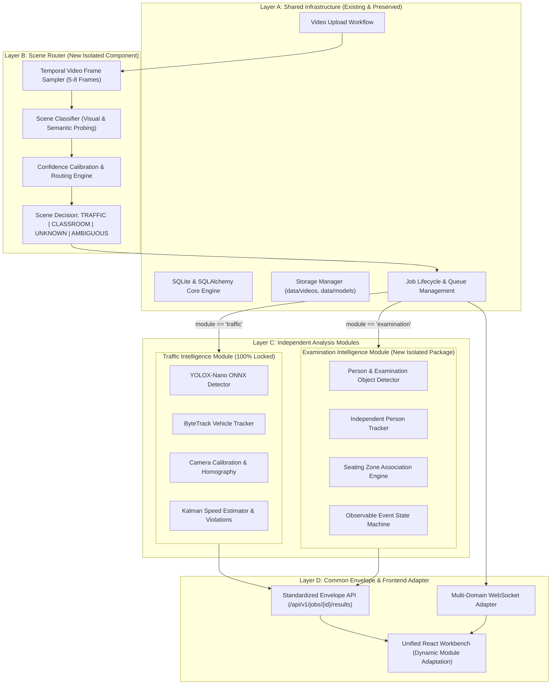

# VisionRadar — Universal Video Intelligence: Architecture Plan (Stage 0)

**Date**: 2026-10-19  
**Status**: APPROVED FOR IMPLEMENTATION  
**Mode**: Strict Zero-Regression, Additive Layering  

---

## 1. System Vision & Architecture Objectives

The objective is to evolve VisionRadar from a single-domain traffic analytics platform into a **modular, multi-domain Universal Video Intelligence Platform**. 

The architecture strictly preserves all existing traffic capabilities while cleanly introducing:
1. **Automatic Scene Classification & Routing** (identifies `TRAFFIC`, `CLASSROOM_EXAMINATION`, `OTHER_UNKNOWN`, `AMBIGUOUS`).
2. **Examination Intelligence Pipeline** (person detection, tracking, seating zone mapping, and neutral observable event analysis).
3. **Unified Frontend & Common Results Adapter** (displays module-appropriate visual overlays, telemetry, and event feeds in the existing Workbench).

---

## 2. Four-Layer Additive Architecture



---

## 3. Layer Specifications

### Layer A: Shared Core Infrastructure (Preserved)
- **Database Engine**: SQLAlchemy models with SQLite database `data/visionradar.db`.
- **Job Lifecycle**: `ProcessingJob` model states: `QUEUED` -> `RUNNING` -> `SUCCEEDED` / `FAILED` / `CANCELLED`.
- **Concurrency & Cancellation**: Active job registry with thread-safe cancellation tokens, ensuring that stopping or queuing a job does not leak system resources.
- **Video Decoding**: Safe OpenCV video frame decoding with exact timestamp resolution.

### Layer B: Scene Router (`packages/visionradar/scene_router/`)
- **Isolation Principle**: The Scene Router operates strictly upstream of analysis pipelines. It does not perform traffic detection, speed estimation, or examination event logic.
- **Sampling Strategy**: Decodes 6 uniformly distributed representative frames across the video lifespan (e.g., at 10%, 25%, 40%, 60%, 75%, 90% of duration). Avoids full video decoding.
- **Classification Method**:
  - Uses a lightweight local visual probe combining TorchVision / OpenCV visual feature analysis (color temperature, edge spatial orientation, indoor ceiling/desk geometry vs outdoor open roadway/sky contrast) and broad object presence probes.
  - Multi-cue temporal voting across sampled frames:
    - If outdoor roadway, vehicles, or highway features dominate across >= 70% of sampled frames -> `TRAFFIC` (recommended module: `traffic`).
    - If indoor classroom/hall, human desks, seated persons, paper/screens dominate across >= 70% of sampled frames -> `CLASSROOM_EXAMINATION` (recommended module: `examination`).
    - If features are conflicting, confidence < 0.65, or equal votes -> `AMBIGUOUS` (requires user confirmation).
    - If neither pattern matches with sufficient confidence -> `OTHER_UNKNOWN` (requires user confirmation).
- **Output Schema**:
  ```json
  {
    "scene_type": "TRAFFIC | CLASSROOM_EXAMINATION | OTHER_UNKNOWN | AMBIGUOUS",
    "confidence": 0.88,
    "recommended_module": "traffic | examination | none",
    "requires_user_confirmation": false,
    "reason": "Dominant indoor classroom geometry with desks and seated persons",
    "model_version": "scene-router-v1.0"
  }
  ```
- **Manual Override Guarantee**: If the user overrides the recommended module, the user's choice is recorded in the job configuration and persists for the lifetime of that job.

### Layer C: Independent Analysis Modules

#### 1. Traffic Intelligence (Locked)
- Uses `data/models/yolox_nano.onnx` (SHA256 verified).
- Uses `TrafficByteTracker`.
- Uses camera calibration homography and metric speed calculation.
- Strictly preserved without modification.

#### 2. Examination Intelligence (`packages/visionradar/examination/`)
- Located in dedicated directory: `packages/visionradar/examination/`.
- **Person & Object Detection (`detector.py`)**:
  - Detects persons, cell phones, books/papers, and laptops using standard ONNX / TorchVision object detection weights.
  - Bounded spatial coordinate outputs: `[x1, y1, x2, y2]`.
- **Person Tracking (`tracker.py`)**:
  - Maintains temporary track IDs (`P-1`, `P-2`, etc.) with occlusion recovery and spatial continuity.
  - Track IDs represent temporary observation tracks, not verified personal identities.
- **Seating Zone Association (`seating.py`)**:
  - Supports configurable polygonal seating areas (`Desk-1`, `Desk-2`, `Aisle`).
  - Computes spatial overlap and centroid containment.
  - Records uncertainty when a track is ambiguous between zones.
- **Observable Event Analysis (`events.py`)**:
  - Analyzes temporal sequences rather than isolated single frames.
  - Emits neutral, verifiable event candidates:
    - `POSSIBLE_PHONE_INTERACTION`
    - `RESTRICTED_ZONE_ENTRY`
    - `LEAVING_SEATING_ZONE`
    - `POSSIBLE_OBJECT_TRANSFER`
    - `REPEATED_ORIENTATION_PATTERN`
  - Every event is marked as reviewable by human proctors with `review_status: PENDING`.
  - Strictly avoids speculative or defamatory labels.

### Layer D: Common Results & Frontend Adapter
- **Standard Common Envelope**:
  ```json
  {
    "job_id": 104,
    "video_id": 12,
    "analysis_module": "examination",
    "timestamp": 14.5,
    "frame_index": 435,
    "result_type": "frame_observation",
    "schema_version": "2.0",
    "payload": {
      "persons": [...],
      "objects": [...],
      "active_events": [...]
    }
  }
  ```
- **Unified Workbench Integration**:
  - Upload modal displays the scene classification recommendation banner with acceptance and manual override buttons.
  - When viewing a Traffic job: displays traffic speed HUD, lane calibration polygon, speed graph, and traffic violations.
  - When viewing an Examination job: displays person bounding boxes, seating zones, active event timeline, and event review table.

---

## 4. Integration Boundaries & Risk Mitigation

| Integration Boundary | Potential Failure Mode | Architectural Guard |
| :--- | :--- | :--- |
| **Video Upload** | Overwriting traffic upload logic | Add scene classification as an optional post-upload step; preserve existing direct job creation |
| **Job Execution** | Shared worker running traffic logic on exam videos | Worker checks `job.config_json['module']`; dispatches to `TrafficJobWorker` or `ExaminationJobWorker` |
| **Database Persistence** | Column collisions or schema locks | Dedicated `examination_*` tables; zero alteration to existing `tracks` or `speed_measurements` |
| **Frontend Canvas** | Speed labels drawn on persons | Canvas render loop checks `activeModule`; renders module-specific overlays |
| **Inference Contention** | Two workers loading heavy models simultaneously | Unified bounded worker queue; ensures one active inference worker runs at a time on CPU |

---

## 5. Architectural Approval Checklist
- [x] Zero changes to `yolox_nano.onnx` or ByteTrack settings.
- [x] Scene Router is completely decoupled from downstream pipelines.
- [x] Examination module isolated in `packages/visionradar/examination/`.
- [x] Common result schema preserves backwards compatibility with existing traffic UI.
- [x] Human-in-the-loop audit design for all examination events.
